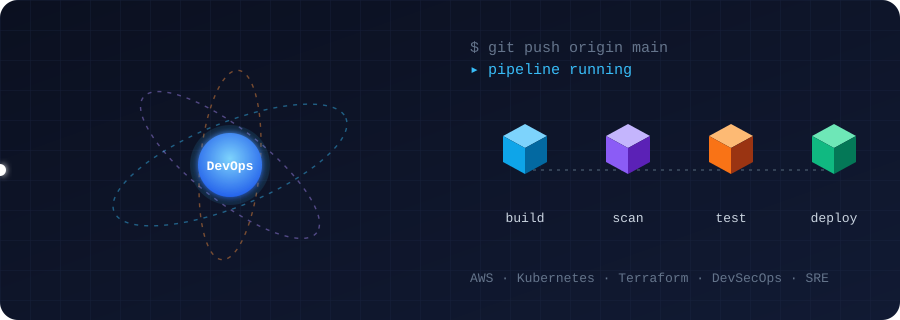
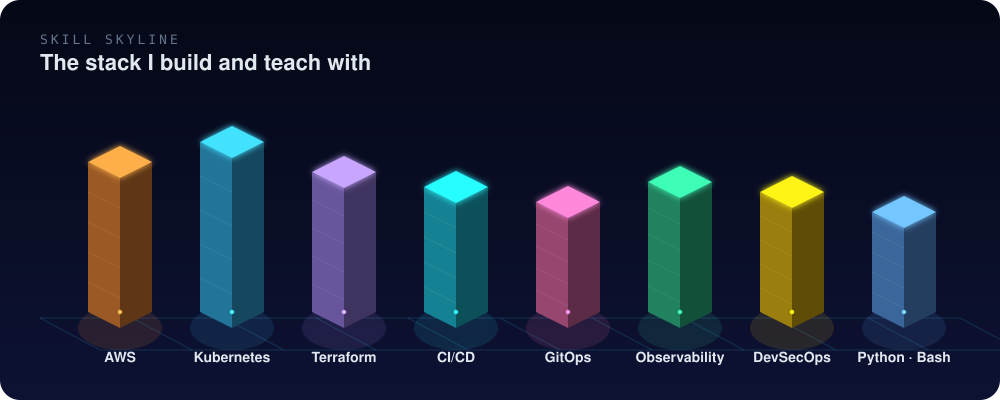

<div align="center">

<a href="https://saikiranpi.in" target="_blank">
</a>

<br/>

<!-- Custom animated 3D hero (assets/hero-orbit.svg) -->


<br/><br/>

<p>
  <a href="https://saikiranpi.in"></a>
  <a href="https://topmate.io/pinapathruni_saikiran"></a>
  <a href="https://www.youtube.com/@SaiKirannPinapathruni"></a>
  <a href="https://www.linkedin.com/in/saikiranpinapathruni/"></a>
  <a href="https://medium.com/@pinapathrunisaikiran"></a>
  <a href="https://hub.docker.com/u/kiran2361993"></a>
</p>

</div>


## `~/whoami`

```yaml
name:       Saikiran Pinapathruni
role:       Cloud & DevOps Architect
founder_of: Cloud Vishwakarma
mentoring:  Engineers moving into Cloud / DevOps / SRE (Topmate 1:1)
stack:      [AWS, Azure, Kubernetes, Terraform, ArgoCD, Jenkins, Prometheus]
focus:      Production-grade, hands-on, security-first delivery
philosophy: "Automate everything. Architect for resilience. Share knowledge relentlessly."
```


## 🚀 Ecosystem

<table>
  <tr>
    <td width="50%" valign="top">
      <h3 align="center">🌐 Cloud Vishwakarma</h3>
      <p align="center"><a href="https://saikiranpi.in"></a></p>
      <ul>
        <li>Hands-on, production-grade DevOps courses and workshops</li>
        <li>Real-time project architectures and cloud sandboxes</li>
        <li>Curriculum for working professionals and career switchers</li>
      </ul>
    </td>
    <td width="50%" valign="top">
      <h3 align="center">🤝 Topmate Mentorship</h3>
      <p align="center"><a href="https://topmate.io/pinapathruni_saikiran"></a></p>
      <ul>
        <li>1:1 career guidance and custom DevOps learning paths</li>
        <li>Resume and LinkedIn optimization</li>
        <li>Mock interviews and salary negotiation coaching</li>
      </ul>
    </td>
  </tr>
  <tr>
    <td width="50%" valign="top">
      <h3 align="center">🎥 YouTube</h3>
      <p align="center"><a href="https://www.youtube.com/@SaiKirannPinapathruni"></a></p>
      <ul>
        <li>Project builds from scratch to production</li>
        <li>AWS, Kubernetes, Terraform and DevSecOps deep dives</li>
        <li>Roadmaps, career Q&amp;A and livestreams</li>
      </ul>
    </td>
    <td width="50%" valign="top">
      <h3 align="center">🐳 Docker Hub and Labs</h3>
      <p align="center"><a href="https://hub.docker.com/u/kiran2361993"></a></p>
      <ul>
        <li>Pre-configured images for quick lab spin-ups</li>
        <li>Multi-tier microservice demo stacks</li>
        <li>CI/CD runner images tuned for security and speed</li>
      </ul>
    </td>
  </tr>
</table>


## 🛠️ Tech Stack

<div align="center">


</div>


## 🏗️ How I Ship: Reference Pipeline

<div align="center">

</div>


## 📚 Featured Repositories

| Repository | Focus | What you get |
| :--- | :--- | :--- |
| 🛡️ [**Mastering-DevSecOps**](https://github.com/saikiranpi/Mastering-DevSecOps) | DevSecOps | Pipeline security: SAST/DAST, SCA, container scanning, compliance |
| 🚢 [**Mastering-Kubernetes**](https://github.com/saikiranpi/Mastering-Kubernetes) | Orchestration | Production clusters, ingress, CNI, storage, zero-downtime rollouts |
| 🏗️ [**Terraform_Modules**](https://github.com/saikiranpi/Terraform_Modules) | IaC | Modular, production-ready Terraform for cloud infrastructure |
| ☁️ [**mastering-aws**](https://github.com/saikiranpi/mastering-aws) | Cloud architecture | Hands-on guides and patterns for core AWS services |
| 🎯 [**DevOps-interview-Kit**](https://github.com/saikiranpi/DevOps-interview-Kit) | Career prep | Scenario questions, architecture puzzles, cheat sheets |


## 🧊 Skill Skyline

<div align="center">

</div>

## 📊 GitHub Stats

<div align="center">


</div>

## 🤝 Let's Connect

<div align="center">

**Want a roadmap, a mock interview, or a production-grade DevOps project review?**

<a href="https://topmate.io/pinapathruni_saikiran">
  
</a>
<a href="https://www.linkedin.com/in/saikiranpinapathruni/">
  
</a>

<br/><br/>

<br/><br/>

<i>"Automate everything, architect for resilience, and share knowledge relentlessly."</i>


</div>
