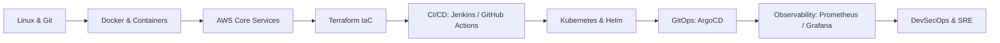

<div align="center">

<a href="https://saikiranpi.in" target="_blank">
  
</a>

<a href="https://saikiranpi.in">
  
</a>

<br/>

<p>
  
  
  
  
  
</p>

<p>
  <a href="https://saikiranpi.in"></a>
  <a href="https://topmate.io/pinapathruni_saikiran"></a>
  <a href="https://www.youtube.com/@SaiKirannPinapathruni"></a>
  <a href="https://www.linkedin.com/in/saikiranpinapathruni/"></a>
  <a href="https://medium.com/@pinapathrunisaikiran"></a>
  <a href="https://hub.docker.com/u/kiran2361993"></a>
</p>

</div>

---

## 👋 About Me

> **"Automate everything, architect for resilience, and share knowledge relentlessly."**

I'm a **Cloud & DevOps Architect** and the founder of **[Cloud Vishwakarma](https://saikiranpi.in)**, where I help engineers build real, production-grade skills in Cloud, DevOps, and SRE, not just certificates. I also mentor engineers 1:1 on career growth, interviews, and architecture.

```yaml
name:        Saikiran Pinapathruni
role:        Cloud & DevOps Architect | Senior Consultant
founder_of:  Cloud Vishwakarma
mentoring:   Topmate 1:1 (career, resume, mock interviews)
core_stack:  [AWS, Kubernetes, Terraform, ArgoCD, Jenkins, Prometheus]
focus:       [Platform Engineering, GitOps, DevSecOps, Observability]
philosophy:  "Build it. Break it. Automate it. Teach it."
```

---

## 🎯 What I Do

<table>
  <tr>
    <td width="33%" valign="top" align="center">
      <h3>🏗️ Architect</h3>
      <p>Design secure, scalable, cost-aware cloud platforms on AWS and Azure with Infrastructure as Code.</p>
    </td>
    <td width="33%" valign="top" align="center">
      <h3>⚙️ Automate</h3>
      <p>Ship faster with CI/CD, GitOps, and zero-downtime delivery pipelines on Kubernetes.</p>
    </td>
    <td width="33%" valign="top" align="center">
      <h3>🎓 Mentor</h3>
      <p>Guide engineers through career transitions, interview prep, and hands-on real-world projects.</p>
    </td>
  </tr>
</table>

---

## 🚀 Ecosystem

| Platform | What you get | Link |
| :-- | :-- | :-- |
| 🌐 **Cloud Vishwakarma** | Production-grade DevOps courses, workshops, real-time project architectures and cloud sandboxes, tailored for working professionals and career switchers. | [saikiranpi.in](https://saikiranpi.in) |
| 🤝 **Topmate Mentorship** | 1:1 career guidance, custom learning paths, resume and LinkedIn optimization, mock interviews, salary negotiation coaching. | [Book a session](https://topmate.io/pinapathruni_saikiran) |
| 🎥 **YouTube** | Step-by-step project builds, AWS / Kubernetes / Terraform / DevSecOps deep dives, roadmaps and live Q&A. | [Subscribe](https://www.youtube.com/@SaiKirannPinapathruni) |
| 🐳 **Docker Hub** | Pre-configured lab images, multi-tier microservice demo stacks, and CI/CD runner images. | [kiran2361993](https://hub.docker.com/u/kiran2361993) |
| ✍️ **Medium** | Articles on cloud architecture, DevOps practices and career growth. | [Read](https://medium.com/@pinapathrunisaikiran) |

---

## 🛠️ Tech Stack

<div align="center">

**☁️ Cloud & IaC**<br/>
<br/><br/>

**🚢 Containers & Orchestration**<br/>
<br/><br/>

**🔄 CI/CD & GitOps**<br/>
<br/><br/>

**📊 Observability & Security**<br/>
<br/><br/>

**💻 Scripting & Data**<br/>


</div>

<details>
<summary><b>➕ More tools I work with</b></summary>
<br/>

<p align="center">
  
  
  
  
  
</p>

</details>

---

## 🧭 DevOps Mastery Path



---

## 📚 Featured Repositories

<table>
  <tr>
    <td width="50%" valign="top">
      <h3>🛡️ <a href="https://github.com/saikiranpi/Mastering-DevSecOps">Mastering-DevSecOps</a></h3>
      Pipeline security: SAST, DAST, SCA, container scanning and compliance.
      <br/><br/>
      
      
    </td>
    <td width="50%" valign="top">
      <h3>🚢 <a href="https://github.com/saikiranpi/Mastering-Kubernetes">Mastering-Kubernetes</a></h3>
      Production cluster architecture, ingress, CNI, storage and zero-downtime rollouts.
      <br/><br/>
      
      
    </td>
  </tr>
  <tr>
    <td width="50%" valign="top">
      <h3>🏗️ <a href="https://github.com/saikiranpi/Terraform_Modules">Terraform_Modules</a></h3>
      Production-ready, modular Terraform templates for cloud infrastructure.
      <br/><br/>
      
      
    </td>
    <td width="50%" valign="top">
      <h3>☁️ <a href="https://github.com/saikiranpi/mastering-aws">mastering-aws</a></h3>
      Hands-on guides and architecture patterns for core AWS services.
      <br/><br/>
      
      
    </td>
  </tr>
  <tr>
    <td colspan="2" valign="top">
      <h3>🎯 <a href="https://github.com/saikiranpi/DevOps-interview-Kit">DevOps-interview-Kit</a></h3>
      Scenario-based questions, architecture interview puzzles and practical cheat sheets.
      <br/><br/>
      
      
    </td>
  </tr>
</table>

---

## 📊 GitHub Analytics

<div align="center">


<br/>


<br/>


<br/>


</div>

---

## 🤝 Let's Work Together

<div align="center">

| 💼 Consulting | 🎓 Training | 🧑‍🏫 Mentorship |
| :--: | :--: | :--: |
| Cloud, DevOps and DevSecOps architecture reviews | Hands-on courses and workshops | 1:1 career coaching and mock interviews |
| [Connect on LinkedIn](https://www.linkedin.com/in/saikiranpinapathruni/) | [Visit the portal](https://saikiranpi.in) | [Book on Topmate](https://topmate.io/pinapathruni_saikiran) |

</div>

---

<div align="center">


<br/><br/>

<i>Crafted with ❤️ for the global DevOps and Cloud community</i>


</div>
